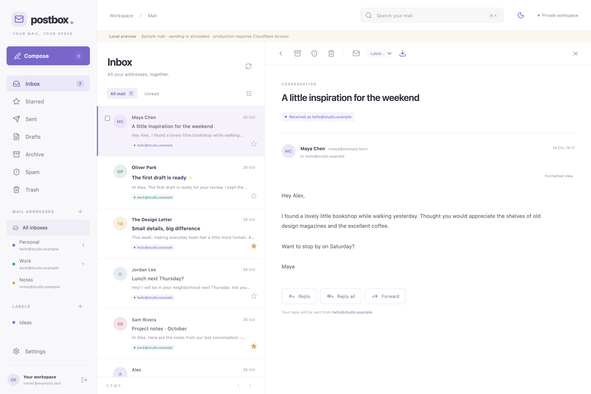
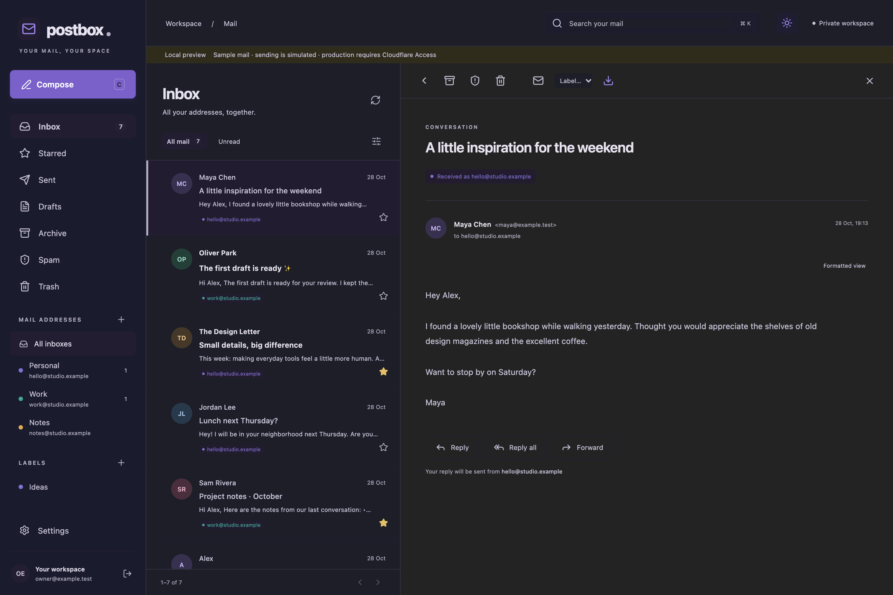
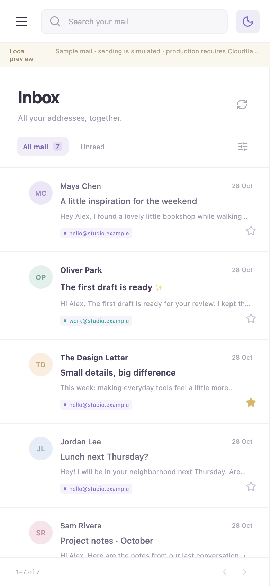

# Postbox

**Your mail. Your space.** A lightweight web mailbox you deploy to your own Cloudflare account.



[Get started](#get-started) · [CLI guide](docs/cli.md) · [Deployment](docs/deployment.md) · [Architecture](docs/architecture.md) · [Security](SECURITY.md)

Postbox brings the addresses on your domains into one calm inbox. Read everything together or switch to a single address. Replies use the address that received the message. Your mailbox, message storage, and access policy stay in your Cloudflare account.

## What you get

- **Multiple domains and addresses.** Explicit aliases, per-address inboxes, a unified inbox, signatures, and pause/resume controls. Catch-all routing still accepts only addresses you have added.
- **The mail essentials.** Search, conversations, stars, folders, labels, contacts, sorting rules, attachments, Cc/Bcc, reply/forward, autosaved drafts, and a short undo-send window.
- **A private workspace.** Cloudflare Access sign-in, an exact email allowlist, and JWT verification inside the Worker. Remote images are blocked; email HTML is sanitized and sandboxed.
- **A comfortable interface.** Light, dark, and system themes, keyboard shortcuts, and layouts for desktop and mobile.
- **A useful terminal companion.** Guided setup, a terminal mailbox, and JSON commands for reading mail or preparing drafts for a human to review.
- **Ownership of your setup.** Named and prefixed resources, domain/DNS configuration, diagnostics, backups, restore, and guarded cleanup.

<details>
<summary>See dark mode and the mobile inbox</summary>





Screenshots use synthetic sample mail.

</details>

## Get started

### Try the local preview

You need **Node.js 22.12+** and npm. No Cloudflare account is needed for the local preview.

```sh
git clone https://github.com/NaxAlpha/postbox.git
cd postbox
npm ci
npm run postbox -- start
```

Open **http://127.0.0.1:5173**. The preview includes sample mail and simulates sending. Local data stays under `.postbox/local`. Keep the development server on loopback.

### Deploy your mailbox

You need a **Cloudflare Workers Paid account**, R2 enabled, domains using Cloudflare DNS, and access to Email Sending and Email Routing. Cloudflare Access protects the browser and mailbox API.

From the same checkout:

```sh
npm link
postbox login
postbox init
postbox deploy
```

The setup wizard lists your accounts and domains, asks which addresses and mailbox hostname to use, and collects the exact emails allowed to sign in. It previews DNS changes before applying them. The CLI uses the pinned Cloudflare **cf** CLI internally and refuses conflicting mail configuration.

`postbox deploy` creates the Worker, D1 database, private R2 bucket, queues, and Access application, then connects mail routing. Run it again to update an installation. MFA is optional and off by default.

Your private configuration and ownership records are gitignored. Keep `mailbox.config.json` and `.postbox/` backed up. See the [deployment guide](docs/deployment.md) for prerequisites, domain constraints, upgrades, and recovery.

## Use the CLI

```sh
postbox deploy --dry-run          # Inspect the deployment plan
postbox doctor                   # Check resources and access protection
postbox auth                     # Sign the CLI into the protected mailbox
postbox tui                      # Open the terminal mailbox
postbox list --silent             # Read inbox summaries as JSON
postbox draft                    # Prepare a draft for human review
postbox view MESSAGE_UUID        # Read a message or saved draft
postbox send MESSAGE_UUID         # Review a draft and confirm sending
postbox help agents              # Automation workflow and safety guidance
```

Commands support `--help`, interactive prompts, and non-interactive use. Add `--silent` or `--json` for structured output. Sending without a terminal requires explicit `--yes`; drafting never sends mail. The CLI and browser share the same saved drafts.

Mailbox sign-in (`postbox auth`, using cf/cloudflared) is separate from Cloudflare account login. See the [CLI guide](docs/cli.md) for authentication, examples, search, pagination, and automation.

## Before you use it for real mail

Postbox is an early release, with build, security, storage integration, and browser regression tests. A private deployment has been tested across two domains, including incoming mail, replies, and forwarding with attachments. [Validation notes](docs/validation/live-2026-10-28.md) and the [security remediation record](docs/security/remediation-2026-10-28.md) describe the checks and their limits.

A few boundaries matter:

- **Cloudflare Email Sending is beta and supports transactional email only.** Confirm eligibility and permitted use before treating Postbox as your everyday mailbox. A Workers Paid subscription alone does not establish sending eligibility. [Cloudflare FAQ](https://developers.cloudflare.com/email-service/reference/faq/)
- **All allowed users share the whole workspace.** This is for an owner or a trusted group. Use separate installations for separate security boundaries.
- **Delivery is distinct from submission.** A send marked `accepted` is not proof of delivery. Optional delivery-event subscriptions require additional setup.
- **This is a web mailbox.** There is no IMAP/POP3 server, mail-client SMTP access, offline mailbox, rich-text editor, or end-to-end encryption.
- **Removal is deliberate.** `postbox destroy` previews the plan; permanent deletion requires `--apply` and the exact resource prefix. Mail deletion also requires verified bucket ownership. Older manifests without ownership evidence fail safely; `--keep-mail` preserves storage.

## Project layout

```text
src/
  client/       React mailbox, themes, and styles
  server/       Authentication, mail processing, API, and storage
  shared/       Types shared by the browser and Worker
  index.ts      Worker HTTP, email, queue, and scheduled handlers
scripts/        Postbox CLI, provisioning, backups, and test helpers
migrations/     Numbered D1 schema migrations
tests/          Security, CLI, installer, and storage regression tests
docs/           Guides, architecture, research, and validation records
.github/        CI, dependency updates, and contribution templates
```

Run `npm run check`, `npm run format:check`, and `npm audit --audit-level=high` before contributing. Browser checks run against the local preview. See [CONTRIBUTING.md](CONTRIBUTING.md) for the workflow and [the documentation index](docs/README.md) for deeper topics.

[MIT licensed](LICENSE). An independent project by [NaxAlpha](https://github.com/NaxAlpha), built on Cloudflare.
