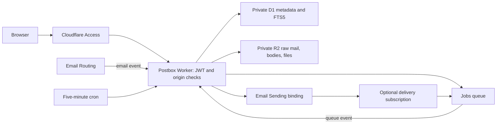

# Architecture and implementation boundaries

The first implementation uses one Worker with HTTP, email, queue, and scheduled handlers. The initial research proposed separate ingress/web/background Workers; consolidating them reduces deployment complexity and resource overhead for a personal mailbox. All handlers share the same bindings, so isolation between these functions is a code boundary rather than separate Worker credentials. Splitting them remains a future hardening option.

## HTTP and identity

Static Assets run Worker-first. The Worker verifies Access's RS256 JWT using the pinned team issuer, app audience, expiry, required human identity fields, and exact email allowlist before serving UI/API/files. Canonical origin checks close alternate URLs even if one is accidentally re-enabled. State-changing requests require exact Origin plus a custom CSRF header; there is no public administration/bootstrap endpoint.

Every permitted user is a trusted workspace administrator. Addresses are identities within that workspace, not independent security tenants. Replies enforce the original receiving address on the server. Attachments must belong to the draft/address when composing; forwarding makes new attachment records rather than mutating originals.

Email HTML is sanitized and shown in an opaque-origin sandboxed iframe with a restrictive CSP. Remote images are replaced with placeholders. Only stored raster CID images are fetched through authenticated routes and embedded using temporary blob URLs; SVG/HTML/files download as octet-stream. Plain-text compose avoids injecting author-controlled HTML.

## Durable intake

Inbound SMTP envelope recipient selects an explicitly registered active address. Unknown/paused recipients are rejected. The raw stream is stored first with recovery metadata, then its intake record and queue reference are persisted. Queue failure leaves durable pending work for the sweep.

Ingest claims one intake atomically, parses MIME with bounds, stores sanitized bodies and files in R2, and inserts indexed metadata in D1. A recipient-plus-SHA256 delivery key deduplicates identical raw delivery. A repeated RFC Message-ID alone does not discard modified mail. RFC threading references are searched within the receiving address only.

Poison/interrupted intake has bounded attempts; it becomes visible failed intake with raw download/retry. Acceptance of SMTP mail is separate from successful parsing, and original messages survive parser failure. Preview limits are 500,000 text characters and 1,000,000 HTML characters; complete received mail remains available as EML.

## Outbound delivery

Drafts use revisions and immutable R2 keys. A save can only update the expected draft revision, so another tab or a racing send cannot overwrite queued content. Submission persists an immutable outbox snapshot, enforces the combined recipient/size/permission limits, and queues a ten-second delayed send. Undo restores the draft before claiming starts.

A send job atomically claims queued work and rechecks address/domain permission. Known rate/quota rejections can retry up to five times; definitive rejection is failed. Provider acceptance returns an ID; recipient delivery needs optional events. Duplicate queue deliveries cannot reclaim accepted/processing jobs.

There is no documented sending idempotency key. A connection failure after provider submission, or termination during submission, cannot be distinguished reliably from acceptance. Those jobs become `unknown`, requiring inspection and manual resolution. This conservative behavior prevents automatic duplicate mail. It is not a claim of exactly-once provider delivery.

Cloudflare controls the outbound RFC Message-ID and only documents a provider email ID in its structured result. They are not assumed equivalent. Reply headers to received mail are supported; correlation for replies to a brand-new outbound thread remains a live provider integration boundary.

## Storage and operations

D1 stores addresses, metadata, FTS5 text, drafts, attachments, contacts, labels/rules, intake/outbox journals, quotas, delivery events, and small audit/settings records. R2 holds private raw EML, body JSON, files, and submission snapshots. Queues carry IDs/events, avoiding message-sized payloads.

Numbered SQL migrations are tracked in `schema_migrations`. Local preview seeds synthetic content only. A production installation starts locked until issuer, audience, allowed users, and hostname are configured; local HTTP loopback behavior does not grant production access.

The manifest records account, installation UUID, prefix, exact IDs/names, ownership, and owned route bodies. Prefixes aid organization; cleanup compares recorded identities and current provider state. Exports/restore are operator tools, not public API endpoints.

Browser code is approximately 82 KiB gzip, plus approximately 5 KiB gzip CSS at the verified build. No external font, script, analytics, image tracking, or service worker is required. Polling is every 30 seconds; WebSockets and offline mail are excluded.

## Validation and live boundaries

Local verification covers signed-token security cases, installer operation ordering/ownership, workerd/D1/R2 storage/processing, MIME deduplication, drafts and concurrent revisions, send/undo, provider request shape through a test double, recipient event ordering, uncertain submission resolution, retained failed intake, and responsive browser interactions.

Limited live validation has since exercised Access-protected assets, domain provisioning, inbound mail, replies, and forwarding with attachments. See [live validation](validation/live-2026-10-28.md) for the verified scope. Maximum-size messages, load behavior, live delivery-event subscriptions, and destructive live teardown remain outside those checks.
