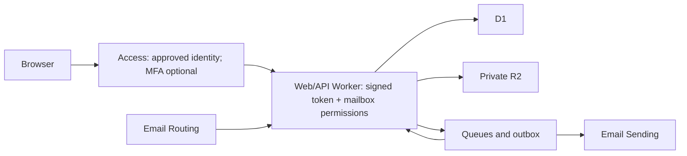

# Cloudflare mailbox: Access authentication and OSS deployment revision

Research date: 14 October 2026. Archived design decisions for a self-hosted OSS mailbox in each deployer's Workers Paid account, using Cloudflare Access and configurable resource prefixes. MFA is optional and disabled by default. See the [current architecture](../architecture.md) and [deployment guide](../deployment.md) for implemented behavior and validation.

## 1. What changes

The mail engine stays Workers + D1 + private R2 + Queues + Email Routing/Sending. Add Access in front of the browser application and enforce identity/authorization again inside the application. Remove the need to implement passwords, application-managed login links, public signup, IMAP/POP3 integration, or native clients. Start with one owner and an optional explicit list of additional users, rather than a centrally hosted public SaaS.

Add an installer, security checks, upgrade support, and ownership-aware cleanup. These are essential OSS features: a successful deployment must result in a protected installation, not simply uploaded Worker code.

Access protects the browser's HTTP path. Inbound SMTP and queue/cron handlers are separate trusted event paths and do not require browser login. The first implementation consolidates HTTP, email, queue, and cron handlers into one Worker; native event handlers expose no separate public HTTP mailbox operations. No Tunnel, VPN client, or always-running server is needed for this proposed Workers deployment.

## 2. Recommended login profile

Use Cloudflare Access with the **Cloudflare identity provider** by default. Cloudflare can authenticate users with their existing Cloudflare account credentials and evaluate account membership; new Zero Trust organizations currently get this provider automatically. Require membership in the deployment account and restrict mailbox admission to configured exact owner/user email addresses. Account membership alone must not admit every account administrator to every mailbox. Additional login providers can be optional configuration. [Cloudflare identity provider](https://developers.cloudflare.com/cloudflare-one/integrations/identity-providers/cloudflare/)

Create one narrowly scoped Allow policy: an exact allowed identity, the selected login method, and the intended account membership restriction. Independent MFA is optional and disabled by default. When opted in, use browser security keys or device biometrics; TOTP can be a future compatibility profile. Do not silently fall back to an email PIN or another weak login method. The application starts with no usable mailbox until the owner is configured; the first visitor never becomes its administrator.

Access is default-deny, but Include rules are OR, whereas Require rules are AND. Do not put a login-method selector beside the owner email as an alternative Include condition, which could admit unrelated users. Avoid Everyone, whole-domain admission, Bypass, public-path overrides, and human mailbox access through service-token policies. [Access policy semantics](https://developers.cloudflare.com/cloudflare-one/access-controls/policies/)

Independent MFA supports WebAuthn security keys, platform biometrics, and TOTP. It requires organization-level enablement, then application/policy enforcement. First authenticator enrollment relies on the initial identity-provider authentication; later authenticator changes require an existing factor. When MFA is enabled, guide owners through enrollment before declaring the install ready and recommend a second authenticator for recovery. Use Cloudflare account recovery/admin controls for recovery, never an unauthenticated mailbox recovery endpoint. [Independent MFA](https://developers.cloudflare.com/cloudflare-one/access-controls/access-settings/independent-mfa/)

Configure explicit mailbox MFA settings: `mfa=false` is the approved default; opt-in enforcement requires organization setup. Policy MFA settings can override application and global requirements; the installer/doctor must inspect every attached policy for an MFA exemption. Enable the required authenticator methods without changing MFA enforcement for unrelated applications. Existing organization settings and IdPs are shared, so preserve them. [MFA enforcement and precedence](https://developers.cloudflare.com/cloudflare-one/access-controls/policies/mfa-requirements/)

Proposed session default: four-hour application/policy tokens and a four-hour MFA freshness window when MFA is enabled, both configurable. Global SSO and MFA sessions have separate lifetimes; expiring an application token alone does not necessarily force fresh IdP login. Logout uses Access's logout mechanism; the browser clears mailbox state. Removing a user also updates application authorization and revokes relevant Access sessions, rather than relying only on a policy change. Signature checking alone does not independently check Access revocation state; edge enforcement remains important. [Session management](https://developers.cloudflare.com/cloudflare-one/access-controls/access-settings/session-management/)

## 3. Protecting the whole deployment

The implementation uses **hostname Access with alternate endpoints disabled**, paired with in-Worker JWT validation for Static Assets compatibility. Worker-level Access remains a future option, scoped to the web/API Worker. Current documentation says it follows the Worker across routes, Custom Domains, workers.dev, and previews. More specific hostname/path applications can override broader protection, so setup must detect overlapping apps. Do not enable account-wide protection automatically: this OSS installation should not change unrelated Workers. Worker-level Access currently rejects WebSocket upgrades; use incremental polling initially. A future WebSocket feature would require hostname-based Access and explicitly closing alternative endpoints. [Workers Access integration](https://developers.cloudflare.com/workers/configuration/cloudflare-access/)

Select one canonical browser origin. A custom hostname such as `mail.example.com` is recommended; workers.dev is disabled in the implementation. With a custom hostname, explicitly disable unused workers.dev and preview URLs in deployment configuration. Do not rely on dashboard-only settings or defaults; upgrades must preserve endpoint protection. [Worker URL configuration](https://developers.cloudflare.com/workers/configuration/routing/workers-dev/), [Preview domain configuration](https://developers.cloudflare.com/workers/previews/custom-domains/)

Keep UI, API, file downloads, and exports on the same origin, avoiding unnecessary cross-origin Access cookies and CORS bypasses. Every message body, attachment, search result, draft, alias edit, and send request requires application authorization. R2 buckets have no public custom domains or r2.dev access; do not use public signed downloads as the default attachment path. [Access CORS behavior](https://developers.cloudflare.com/cloudflare-one/access-controls/applications/http-apps/authorization-cookie/cors/)

### Static Assets integration detail

Our planned web Worker uses Static Assets. The internal router does not pass `ctx.access` to that Worker, even though Access protects its assets. Therefore, do not build its API around `ctx.access` being present. Configure Worker-first routing for all application requests and validate the signed Access assertion before serving assets or API responses. [Static Assets routing](https://developers.cloudflare.com/workers/static-assets/routing/worker-script/)

Verify `Cf-Access-Jwt-Assertion` cryptographically using the configured team's signing keys, the exact trusted issuer, the installation's application audience, token expiry, allowed algorithm, and required human identity claims. Support signing-key rotation with bounded caching; deny access if validation fails. Never trust the plain email header or a decoded-but-unverified JWT. Resolve verified identities to the explicit shared-workspace allowlist. Every admitted user can administer all configured addresses in this first release. Do not accept a service identity as a human owner. [Access JWT validation](https://developers.cloudflare.com/cloudflare-one/access-controls/applications/http-apps/authorization-cookie/validating-json/)

Live validation must confirm assertion forwarding through hostname Access plus Static Assets and test the Access app/audience actually issued. Do not relax authentication to accommodate an integration issue.

The consolidated Worker has no RPC/service-binding identity handoff. Background jobs persist authorized workspace submissions and recheck address/domain send permission before execution; they do not impersonate a browser session.

## 4. Security requirements beyond login

These are proposed application requirements, not automatic guarantees supplied by Access:

- Enforce authorization on every record/file request; reject unlisted users, foreign draft attachments, and invalid reply/sending identities within the shared workspace.
- Check exact Origin on state-changing browser requests, use CSRF protection, and never mutate mailbox state through GET requests. Do not use wildcard credentialed CORS.
- Use prepared SQL, bounded input sizes, output encoding, and limits on parsing, uploads, exports, and sends.
- Treat email HTML and files as attacker-controlled. Sanitize HTML, use a restricted iframe and CSP, block scripts/forms/navigation, block remote trackers, and deliver risky files as downloads.
- Use private/no-store responses for mailbox data and avoid caching them in a service worker. Disable persistent offline mail by default and clear in-memory/browser state on logout.
- Keep provisioning credentials out of browser assets and normal runtime. Prefer bindings. If web management of provider routing needs a token, isolate a minimal server-side management credential scoped to intended operations/resources.
- Redact tokens, bodies, and attachments from logs. Record security-relevant changes without exposing mail content.
- Avoid URL-based auth tokens, third-party scripts in the mailbox, and broad proxy endpoints. Any optional remote-image proxy needs network/URL restrictions.
- Treat a compromised Cloudflare account as a serious trust-boundary breach: account admins can modify code and data. Secure the account and its recovery path, restrict installer/CI credentials, and document that Access is not end-to-end email encryption.

OSS release requirements include SECURITY.md, a threat model, a clear supported-version policy, pinned build dependencies/CI actions, and automated tests for auth bypass, malformed tokens, wrong issuer/audience, cross-user access, CSRF, hostile HTML, and attachment access after logout. Deployment validation must test signed-in and signed-out requests against every enabled URL, not merely inspect configuration.

## 5. Resource prefix and cleanup design

Provide one deployment `resourcePrefix`, for example `my-mail-prod`, plus optional explicit names for individual resources. Validate the prefix against every derived resource's naming requirements, including suffix lengths; do not silently truncate names or let two installations collide. An environment suffix and an installation UUID distinguish separate installations.

| Resource                                           | Example generated name       |
| -------------------------------------------------- | ---------------------------- |
| Combined mailbox Worker                            | `my-mail-prod-app`           |
| D1 database                                        | `my-mail-prod-db`            |
| R2 mail bucket                                     | `my-mail-prod-mail`          |
| Jobs queue                                         | `my-mail-prod-jobs`          |
| Dead-letter queue                                  | `my-mail-prod-dlq`           |
| Access application                                 | `my-mail-prod-access`        |
| Reusable Access policy                             | `my-mail-prod-users`         |
| Optional manually registered delivery subscription | `my-mail-prod-events-DOMAIN` |

Binding identifiers such as `DB` and `MAIL_BUCKET` can remain stable internal code names while the Cloudflare resources they reference get configurable names. Domains and DNS record names must follow their actual mail/HTTP purpose, rather than an arbitrary prefix. Provider-assigned IDs cannot be prefixed; record them in installation state. Cron triggers, bindings, routes, email routing rules, event subscriptions, and owned DNS records also need tracking even when they have no user-facing resource name.

Keep a private installation manifest with account/zone IDs, install UUID, version, prefix, exact resource IDs/names, dependency relationships, and **created versus reused** ownership. Store no credentials in it. Retain a local copy so teardown still works if the app or its D1 database is unavailable. Verify the manifest against the selected account and current resources before use.

Prefix filtering is useful for discovery and dashboard organization. **Deletion must use verified manifest ownership and exact IDs**, not delete every matching name. Shared Zero Trust organizations, IdPs, pre-existing policies, domains, and existing MX records remain shared infrastructure. If a manifest is missing, show discovered candidates for review rather than claiming ownership based on names.

Proposed cleanup modes:

- **Remove application, retain mail:** remove owned ingress/routes/subscriptions and compute resources while preserving D1/R2 and backups, and explain how to restore them.
- **Complete removal:** explicitly include the owned database, message objects, queues, and optionally backups, with a data-loss confirmation and export option.

In both modes show a concrete dry-run plan, stop new intake/sending, and account for queued work. Disable/remove public application endpoints before removing its Access protection. Delete only owned configuration references, remove Workers/bindings in dependency order, and keep Access protection until no application endpoint can serve mail. Check for resources now referenced by other installations. An R2 bucket must be emptied before deletion; retained/locked data should produce an explicit incomplete-cleanup result rather than silent success. [R2 deletion behavior](https://developers.cloudflare.com/r2/buckets/delete-buckets/)

## 6. OSS setup and upgrades

Recommended setup flow:

1. Authenticate the local installer to the chosen Cloudflare account with cf CLI; inspect existing resources and naming collisions.
2. Collect prefix, canonical browser hostname or protected workers.dev option, owner identity, mail domains, and any per-resource name overrides. The implementation requires a canonical custom hostname.
3. Confirm Workers Paid and Email Service eligibility; enable/reuse Zero Trust and the appropriate identity provider. Workers Paid alone does not substitute for Zero Trust setup. [Workers Access prerequisites](https://developers.cloudflare.com/workers/configuration/cloudflare-access/)
4. Provision storage/queues and record each result immediately so failed or interrupted setup can resume safely.
5. Deploy a locked application without an exposed mailbox bootstrap path. Create a reusable Access policy, attach it to the Access application by reference, configure the chosen IdP and explicit MFA, and pin the resulting audience/issuer in runtime configuration. [Reusable policy API](https://developers.cloudflare.com/api/resources/zero_trust/subresources/access/subresources/policies/methods/create/)
6. Have the configured owner complete a browser login check; enroll MFA only if opted in. Test unauthorized access and endpoint coverage before declaring readiness.
7. Enable selected mail routes only after storage/processing readiness and deliberate MX migration choices. Save the installation manifest and recovery instructions.

Provide setup, plan, doctor, upgrade, export, and uninstall workflows. These tools are implemented and locally exercised; live API behavior remains an acceptance check after account configuration. Use cf CLI for provisioning under your AGENTS.md rule, unless an existing project has Wrangler configuration. Runtime code uses bindings and narrowly scoped APIs where needed; it does not shell out to cf.

Upgrades must preserve prefix/resource IDs, retain issuer/audience pinning unless an Access app is deliberately recreated, run migrations with recovery instructions, and rerun access tests. Development uses synthetic mail and isolated resources; its authentication simulation must not become a production bypass.

Cloudflare's current Zero Trust Free plan has a 50-user limit, so a personal installation can generally use Access without an additional Access subscription. Zero Trust and Workers are separate plan choices; existing seats in the account count too. Paid support/SLA and higher user counts have different pricing. [Zero Trust pricing](https://www.cloudflare.com/plans/zero-trust-services/)

## 7. Remaining choices and unchanged constraints

Your decisions already settle authentication, browser-only access, self-hosted distribution, and configurable resource naming. Remaining deployment inputs are prefix, owner identity, account, domains, and browser hostname. Recommended project defaults are single owner, Cloudflare login, optional MFA disabled by default, four-hour sessions, private file access, and polling.

The first implementation uses the MIT license, which can be revisited before publishing. Additional users, alternate IdPs, TOTP compatibility, offline mail, and notifications can remain optional configuration/features.

Access does not change Cloudflare Email Sending's documented transactional-only scope, outbound/inbound message limits, or the domain-routing constraints in the original research. The everyday-correspondence fit still needs resolution before making broad claims about a general-purpose replacement mailbox. No live Access configuration, MFA enrollment, deployment, or deletion was performed during this research.
