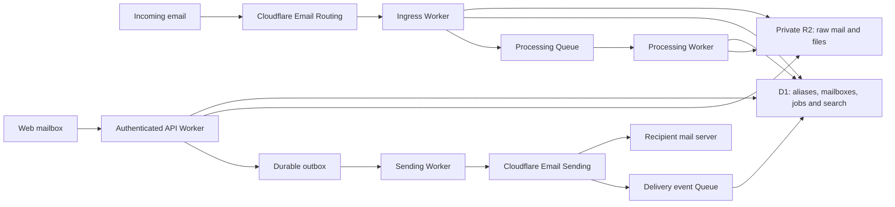

# Cloudflare mailbox: research and proposed system

Research date: 14 October 2026. Status: proposed design, archived design research; refer to the architecture and deployment guides for current behavior.

**Revision:** self-hosted OSS in each deployer's Workers Paid account; browser-only; Cloudflare Access required; security as a release requirement; configurable prefixes and ownership-aware cleanup. The [Access design](access.md) records the authentication and deployment decisions. The implemented [architecture](../architecture.md) is authoritative where this early research differs.

## 1. Recommendation and feasibility

Build a lightweight web mailbox with one unified inbox across selected Cloudflare domains, with aliases as first-class identities. Use Cloudflare Email Routing for ingress, Workers for application logic, R2 for message content and files, D1 for mailbox records and search, and Queues for processing and delivery events. These are design recommendations, not features Cloudflare supplies as a ready-made mailbox.

The most consequential open question is outbound use. Cloudflare's current FAQ describes Email Service as transactional-only. It does not explicitly establish that unrestricted personal or business correspondence is a supported use. Marketing is outside the documented current scope. If this is intended to replace your everyday email provider, obtain clarification from Cloudflare before committing to Cloudflare-only sending. Keep a small sending-provider interface in the design so transport can change without replacing the inbox. [Email Service FAQ](https://developers.cloudflare.com/email-service/reference/faq/)

Sending remains labelled Beta. Cloudflare documents Workers bindings, HTTP APIs, and authenticated SMTP; receiving can route into a Worker. The reviewed documentation does not provide a hosted mailbox with IMAP/POP3 retrieval, mailbox folders, or user credentials for individual inboxes. Our web app must provide these mailbox functions. Native mail-client compatibility would require an additional backend or integration. [Email Service overview](https://developers.cloudflare.com/email-service/), [SMTP reference](https://developers.cloudflare.com/email-service/api/send-emails/smtp/)

I interpret “all available domains” as every eligible domain you control in the selected Cloudflare accounts. This does not mean sending as arbitrary third-party domains or reading Gmail/Outlook mailboxes. Domain inventory and account eligibility have not been checked against your live account. No account resources or DNS records were changed during this research.

## 2. What the interface looks like

The desktop interface has three adjustable columns: navigation, conversation list, and reading pane. On a phone it becomes a single-column navigation flow. A persistent search bar and Compose button stay easy to reach.

```text
┌────────────────────────────────────────────────────────────────────────────┐
│ Mail                         Search messages…                 Compose      │
├────────────────┬───────────────────────────┬───────────────────────────────┤
│ All inboxes    │ Inbox   [All domains ▾]   │ Conversation                  │
│ Inbox          │                           │                               │
│ Starred        │ Sender · subject          │ To: shopping@example.com      │
│ Sent           │ Preview · domain · time   │ Reply as this alias           │
│ Drafts         │                           │                               │
│ Archive        │ Sender · subject          │ Safe HTML / plain text        │
│ Spam           │ Preview · alias · time    │ Attachments                   │
│ Trash          │                           │                               │
│                │                           │ Reply · Reply all · Forward    │
│ Domains        │                           │                               │
│ Aliases   [+]  │                           │                               │
│ Labels         │                           │                               │
│ Settings       │                           │                               │
└────────────────┴───────────────────────────┴───────────────────────────────┘
```

The default screen should feel like familiar email. Infrastructure health stays in Domains and Settings, except when a problem affects receiving or sending.

- **Unified inbox:** all authorized mailboxes together; one-click domain, mailbox, alias, unread, and attachment filters.
- **Reading:** threaded messages, quoted-text collapse, a clear received-as identity, attachment downloads, and a visible warning before loading remote images.
- **Compose:** simple formatting, plain-text alternative, To/Cc/Bcc, autosaved drafts, sender selector, signature, attachment size feedback, and a short undo-send delay before submission.
- **Aliases:** search, create, copy, pause, and organize addresses. Enter a name or generate a random one, select a domain, select its mailbox, and save. Show separate receive and send status.
- **Domains:** list discovered zones and configured subdomains; show Eligible, Needs setup, Receive ready, Send ready, or Conflict with existing mail. Discovery does not automatically enable domains.
- **Power features:** keyboard shortcuts, command palette, multi-select, bulk archive/label actions, and saved searches, with visible buttons for users who do not use shortcuts.

Proposed performance goals: fast first inbox render, small initial JavaScript payload, paginated or virtualized lists, bodies loaded only when opened, and no attachment downloads before requested. Establish numeric budgets once target devices and a representative dataset are known. Cache the app shell for an installable PWA; persistent offline email storage is a separate privacy decision.

## 3. Proposed architecture



Logical components can share a codebase. Initially use an app/API Worker, a small inbound Worker, and a background Worker, with narrowly scoped bindings. Separating incoming MIME processing from the UI reduces interference from expensive messages.

| Component                          | Proposed role                                                               | Start now?         |
| ---------------------------------- | --------------------------------------------------------------------------- | ------------------ |
| Workers + Static Assets            | Web application and authenticated API                                       | Yes                |
| Cloudflare Access                  | Mandatory browser authentication, explicit user admission, and optional MFA | Yes                |
| Email Routing + Email Workers      | Receive mail and resolve its destination                                    | Yes                |
| Email Sending binding              | Outbound transport, subject to use-case confirmation                        | Yes, conditionally |
| D1                                 | Accounts, domains, aliases, messages, state, jobs, keyword search           | Yes                |
| Private R2                         | Raw inbound EML, body objects, attachments, exports                         | Yes                |
| Queues + dead-letter handling      | MIME processing, sending jobs, delivery events                              | Yes                |
| Scheduled Worker handler           | Repair stalled jobs, enforce retention, reconcile domain status             | Yes                |
| Durable Objects                    | Live updates or coordination if needed                                      | Defer              |
| Workflows                          | Long imports, exports, or complex onboarding                                | Defer              |
| Workers AI / Vectorize / AI Search | Optional summaries or semantic search                                       | Defer              |
| KV                                 | Optional non-critical configuration caching                                 | Defer              |

Static Assets can host the frontend alongside Workers APIs. D1 supports SQLite FTS5, so keyword search does not require a separate search service initially. [Static Assets](https://developers.cloudflare.com/workers/static-assets/), [D1 SQL extensions](https://developers.cloudflare.com/d1/sql-api/sql-statements/)

D1 is a good starting choice for a personal mailbox or small team. Paid databases have a 10 GB maximum and 2 MB row/string/BLOB limits; include searchable text in bounded chunks and keep full bodies in R2. Plan database partitioning by workspace as volume grows. Those thresholds are database limits, not mailbox attachment limits. [D1 limits](https://developers.cloudflare.com/d1/platform/limits/)

## 4. Domain and alias model

Domain registration need not be through Cloudflare, but Email Service's setup guides require Cloudflare DNS. Sending and receiving are independently onboarded. Internationalized domain names are supported for routing; internationalized local parts are not. Dots remain meaningful in address patterns. [Sending setup](https://developers.cloudflare.com/email-service/get-started/send-emails/), [Receiving setup](https://developers.cloudflare.com/email-service/get-started/route-emails/), [Postmaster limitations](https://developers.cloudflare.com/email-service/reference/postmaster/)

**Apex domains:** connect a Cloudflare catch-all rule to the inbound Worker, then look up addresses in our alias registry. This supports many application aliases without one provider rule per alias. Existing explicit Cloudflare rules can take precedence and bypass the Worker; reconcile them during onboarding. The catch-all transport rule does not imply that the application accepts every unknown address.

**Subdomains:** the current docs allow literal address rules, but catch-all is apex-only. Create and reconcile explicit provider rules for subdomain aliases; keep an alias Pending until its route works. Do not promise unlimited arbitrary subdomain aliases. Plus addressing can reduce rule requirements for tagged addresses based on an existing rule. [Routing rules and plus addressing](https://developers.cloudflare.com/email-service/configuration/email-routing-addresses/), [Subdomain configuration](https://developers.cloudflare.com/email-service/configuration/subdomains/)

Alias resolution should follow this order:

1. Exact registered address, including an exact plus address.
2. Enabled plus-address fallback to an authorized base alias.
3. Optional domain catch-all mailbox.
4. Reject an unknown address under the default policy.

Reserve disabled and deleted aliases so a broad catch-all cannot reactivate them accidentally. Make pause behavior explicit: reject, quarantine, or deliberate silent discard. Default to reject; keep existing messages readable. Use a database uniqueness constraint for address ownership and do not use an eventually consistent cache as the authority for permission revocation.

An alias is an address routed to a mailbox; a mailbox owns message organization; a sender identity has explicit permission to send. These must be separate records. Creating a receiving alias must not grant arbitrary send access merely because its domain is verified.

On reply, select the authorized alias that received the message. Respect Reply-To for the destination and make any unusual destination visible. If several of the user's identities received it, offer a sender choice. Reply-all excludes the user's own identities and never reveals Bcc recipients.

Alias types supported by the application: named, generated/random, receive-only, send-and-receive, plus-tagged, expiring, and optionally forwarding. Cross-domain replication should be an explicit batch operation, not an assumption that the same name means the same mailbox everywhere.

Forwarding through Cloudflare requires verified external destinations. Replying from Gmail to a forwarded message does not automatically preserve our alias. Reply through our app, or later implement a separate reverse-alias relay. The latter adds loop prevention, identity mapping, and abuse controls. [Inbound Worker API](https://developers.cloudflare.com/email-service/api/route-emails/email-handler/), [Postmaster forwarding behavior](https://developers.cloudflare.com/email-service/reference/postmaster/)

Existing Google Workspace, Microsoft 365, or other receiving services need special handling. Cloudflare Routing requires its MX setup and the domain configuration guide disallows simultaneous external mail servers for ordinary routing. Mixing MX priorities does not split recipients between providers. Choose a full migration, a dedicated subdomain, or an explicit integration with the existing provider. Sending alone uses separate bounce records and should be evaluated independently. [Domain configuration](https://developers.cloudflare.com/email-service/configuration/domains/)

## 5. Limits that affect product behavior

| Documented limit                           | Value                                   |
| ------------------------------------------ | --------------------------------------- |
| Ordinary outbound total message size       | 5 MiB including attachments             |
| Outbound to verified destination addresses | 25 MiB exception                        |
| Inbound total message size                 | 25 MiB                                  |
| To + Cc + Bcc recipients                   | 50 combined                             |
| Custom headers                             | 16 KB combined                          |
| Routing rules                              | 200 per domain                          |
| Verified forwarding destinations           | 200 per account                         |
| Domains configured for sending/routing     | 30 per zone, including apex             |
| Daily sending quota                        | Account-dependent; inspect actual quota |

Verified-address sends are free and exempt from daily/monthly sending quotas. These are documented limits as of the research date. [Email Service limits](https://developers.cloudflare.com/email-service/platform/limits/)

Design consequences: receiving a large attachment does not mean it can be forwarded as a new outbound attachment. Estimate MIME/base64 expansion before accepting a compose upload. An optional private file-link feature can handle larger files, with recipient access and expiration controls. Do not switch transports or publish files silently.

The Workers API also documents a 32-attachment limit through its error reference. Validate provider capabilities in one backend policy used by the UI and sending jobs. [Workers sending API](https://developers.cloudflare.com/email-service/api/send-emails/workers-api/)

## 6. Reliable message handling

**Receiving:** route using the SMTP envelope recipient exposed as `message.to`, retaining the original alias and tag. Header To/Cc can omit recipients such as Bcc. Neither envelope nor header sender alone establishes identity; use trusted authentication results, and treat user-supplied headers as untrusted.

Persist the raw MIME stream to R2 with an intake identifier and envelope metadata. Record a processing job durably before completing successful intake. Enqueue only small identifiers and R2 object keys; a periodic reconciler repairs persisted jobs that were not queued. R2 objects without database records need a recovery scan as well. Parse in the background with a standards-aware MIME parser, produce message metadata and text chunks, and store extracted files privately. Parsing failures retain raw mail and expose a recoverable processing error.

Queues has a 128 KB message limit and at-least-once delivery. Deduplicate jobs and recipient-delivery records; never place full mail or attachments in queue payloads. Include recipient identity in deduplication so a delivery to one alias cannot hide delivery to another. [Queue limits](https://developers.cloudflare.com/queues/platform/limits/), [Queue delivery guarantees](https://developers.cloudflare.com/queues/reference/delivery-guarantees/)

Workers memory is limited to 128 MB per isolate. Large multipart fixtures must be tested under concurrent load; streaming raw storage first avoids unnecessary buffers, but MIME parsing still needs measured memory bounds and fallback behavior. [Workers limits](https://developers.cloudflare.com/workers/platform/limits/)

**Sending:** autosave the draft; on Send, create an immutable submission and an outbox record. A database claim prevents concurrent workers from processing the same submission. The optional undo interval holds it before provider submission. The sender rechecks alias authorization and limits, submits, and records the provider result.

Cloudflare's binding returns a message ID; the REST API returns recipient outcomes and its API schema includes message ID and suppressed-recipient fields. Normalize results behind the transport interface. An accepted submission is not proof of inbox placement. [Workers sending API](https://developers.cloudflare.com/email-service/api/send-emails/workers-api/), [REST sending API](https://developers.cloudflare.com/email-service/api/send-emails/rest-api/), [Send API schema](https://developers.cloudflare.com/api/resources/email_sending/methods/send/)

Use delivery event subscriptions per sending domain to update per-recipient state: delivered, deferred, bounced, failed, rejected, and complained. Deduplicate events and prevent an older event from overwriting a terminal outcome. Delivery means recipient-server acceptance, not that a person read the message. Routing events and deliveries to verified routing recipients are excluded from these sending subscriptions; track those paths separately. [Sending event subscriptions](https://developers.cloudflare.com/email-service/platform/event-subscriptions/)

The reviewed send interfaces do not document a provider idempotency key. A timeout after provider acceptance can produce an ambiguous outcome. Mark it Unknown and reconcile logs/events before retrying; application deduplication alone cannot guarantee exactly-once external email delivery. Do not resubmit merely because Cloudflare is retrying an accepted soft bounce.

Store the app submission ID, provider ID, and RFC Message-ID separately until their relationship is verified. Use In-Reply-To and References for threading; do not merge conversations across mailboxes merely because they share a subject. The platform controls generated Message-ID and Date headers; custom threading headers are supported with length limits. Preserve relevant references within those limits. [Email headers](https://developers.cloudflare.com/email-service/reference/headers/)

`message.reply()` is designed for a reply during inbound handling and has authentication, recipient, sender-domain, and one-reply restrictions. Human replies hours later use the outbound send path, with proper threading headers. [Inbound Worker API](https://developers.cloudflare.com/email-service/api/route-emails/email-handler/)

## 7. Necessary and optional features

| Area         | Necessary for the first usable release                                                        | Optional or later                                                 |
| ------------ | --------------------------------------------------------------------------------------------- | ----------------------------------------------------------------- |
| Mail         | Receive, compose, reply, reply-all, forward, Sent, drafts                                     | Scheduling, vacation replies, templates                           |
| Organization | Inbox, archive, spam, trash, read/unread, stars, labels/folders, bulk actions                 | Snooze, priority inbox, advanced views                            |
| Search       | Sender, recipient, subject/body, domain/alias, dates, unread, attachments                     | Semantic search, attachment-content extraction                    |
| Identity     | Multiple domains, named/random aliases, pause, sender selection, signatures                   | Expiry presets, reverse aliases, cross-domain batch creation      |
| Contacts     | Basic address book and autocomplete                                                           | CardDAV, external contact synchronization                         |
| Rules        | Basic sender/recipient/domain rules to label, archive, or quarantine                          | Complex chains, external automation                               |
| Attachments  | Safe downloads, inline images, upload validation and size feedback                            | Large-file sharing, document preview, antivirus service           |
| Security     | Authenticated sessions, authorization, private storage, sanitized HTML, remote images blocked | S/MIME, PGP, specialized key management                           |
| Reliability  | Durable intake/outbox, retries, deduplication, visible errors, recovery/export                | Independent off-provider backups, advanced operational dashboards |
| UX           | Mobile web, accessibility, keyboard support, autosave, immediate state feedback               | Offline mail, push alerts, desktop/native clients                 |
| Teams        | Data model leaves room for separate owners                                                    | Shared inbox assignment, delegation, roles, notes                 |
| AI           | None required                                                                                 | Opt-in summaries, drafting, classification                        |

Spam filtering and safe rendering are essential; AI is not required for either. Cloudflare's example spam filters are starting patterns, not a complete mailbox spam or malware solution. The application needs its own quarantine, block/allow controls, and conservative handling of suspicious content. [Spam filtering example](https://developers.cloudflare.com/email-service/examples/email-routing/spam-filtering/)

## 8. Security, privacy, and recovery

Use Cloudflare Access with explicit approved identities; MFA is optional and disabled by default. The OSS default is Cloudflare itself as the identity provider, with the deployment account membership restricted to specifically configured mailbox users. Verify signed Access tokens inside the web/API Worker and use an independent account recovery path. This replaces custom passwords or application-managed login links. See the Access and OSS revision for the complete security and deployment requirements.

Scope every query and attachment request to an authorized workspace/mailbox. Keep Cloudflare configuration credentials server-side, separate them from send access, and audit domain and alias changes. Never give ordinary users Cloudflare SMTP API tokens: the SMTP documentation warns that possession allows sending from onboarded domains in the matching account. [SMTP authentication](https://developers.cloudflare.com/email-service/api/send-emails/smtp/)

Sanitize email HTML, render it in a restricted sandbox, block scripts/forms and remote tracking content, and serve untrusted files with safe content headers. Malware scanning is a separate integration; do not label an attachment safe solely because Cloudflare routed it. Only proxy remote content after explicit permission, with URL and network restrictions.

Separate inbound blocklists from outbound provider suppressions. Show suppression reason and expiration; honor read-only flags and avoid automatic removal. Cloudflare supports account and exact-sending-domain scopes, with different complaint/hard/soft bounce lifetimes. Keep suppressed-recipient dropping off initially so the UI can explain a failed send rather than silently omit someone. [Suppression behavior](https://developers.cloudflare.com/email-service/concepts/suppressions/), [Suppression management](https://developers.cloudflare.com/email-service/configuration/suppressions/)

Proposed retention defaults: keep normal mail until the owner deletes it; trash purges after 30 days, spam after 30 days; quotas and backup retention remain configurable. Show the purge date and remove corresponding content, files, search records, and cached copies. Deleted aliases retain a minimal ownership tombstone. An independent backup is recommended for important mail; in-account storage alone does not cover account compromise.

D1 Time Travel provides a paid-plan recovery window of 30 days, but it does not restore R2 objects. Backups and restore tests must cover both records and objects and specify how recent deletions are honored during recovery. Export original inbound EML and mailbox metadata; outbound export uses stored compose content plus recorded generated headers unless exact transmitted MIME is available. [D1 recovery](https://developers.cloudflare.com/d1/reference/time-travel/)

Cloudflare analytics retain 31 days; sent previews, when enabled, retain approximately seven days and are enabled by default for new sending domains. They cannot act as a durable Sent folder. Decide whether to disable provider previews to minimize extra content copies. Keep message content out of routine application logs. [Email analytics](https://developers.cloudflare.com/email-service/observability/metrics-analytics/), [Email logs and previews](https://developers.cloudflare.com/email-service/observability/logs/)

Ordinary hosted storage and transport security do not make this end-to-end encrypted mail: server-side parsing/search and the mail transport access content. Client-side encryption would require a different search, recovery, and processing design. Region requirements also need checking across ingress, Workers, Queues, D1, R2, and logs; an R2 location hint alone is not a residency guarantee. [R2 locations and jurisdictions](https://developers.cloudflare.com/r2/reference/data-location/)

## 9. Costs and scale

The current Workers Paid subscription starts at $5/month. Email Sending includes 3,000 outbound emails per account per billing month, then $0.35 per 1,000; inbound routing is unlimited, while Worker processing is billed separately. These allowances are shared with other use in the account. [Workers pricing](https://developers.cloudflare.com/workers/platform/pricing/), [Email Service pricing](https://developers.cloudflare.com/email-service/platform/pricing/)

Illustration using 10,000 single-recipient, quota-counted outbound sends in a month:

- Email sending: `(10,000 − 3,000) / 1,000 × $0.35 = $2.45`.
- Workers subscription plus sending: **$7.45**, before storage, operations, processing overages, authentication, backups, or optional integrations.

This is arithmetic from published prices, not a complete bill estimate. Multi-recipient billing behavior should be confirmed before forecasting that traffic.

R2 Standard storage includes 10 GB-months; additional storage is $0.015/GB-month, with operations billed separately and direct egress free. For 50 GB-months of actual stored objects, the storage portion is approximately $0.60 beyond the included allowance. Storing both raw MIME and extracted attachments increases the actual stored volume. [R2 pricing](https://developers.cloudflare.com/r2/pricing/)

Get expected users, domains, aliases, messages/day, average message size, retained years, and existing account usage before making a monthly budget. Apply per-mailbox storage quotas and outbound rate limits from the start. Large retained search indexes and catch-all spam can cost more than sending.

## 10. Decisions needed to lock the design

| Decision                         | Recommended starting point                                                              | Why it matters                                                              |
| -------------------------------- | --------------------------------------------------------------------------------------- | --------------------------------------------------------------------------- |
| Who uses it?                     | **Locked: self-hosted OSS, one deployment per owner account**                           | One owner by default; additional users explicitly authorized                |
| What mail do you send?           | Clarify everyday correspondence versus transactional/support mail                       | Determines whether Cloudflare-only sending is an appropriate documented fit |
| Which domains/accounts?          | Select eligible domains from one account initially                                      | Multiple account credentials and routing ownership add complexity           |
| Existing mail provider?          | Preserve current receiving until a migration is chosen                                  | Receiving depends on MX ownership; avoid interrupting existing mail         |
| Web only or native mail clients? | **Locked: fully web-based**                                                             | Native mailbox protocol integration is outside project scope                |
| Alias behavior?                  | Registered aliases + plus tags; unknown addresses rejected                              | True catch-all accepts spam and typos; reverse aliases add a relay          |
| Large outbound files?            | Enforce transport limit; optional private file links                                    | Another transport or sharing feature is needed for larger files             |
| Identity and privacy?            | **Locked: Cloudflare Access, optional MFA off by default**; server-side search proposed | Residency and E2E requirements remain separate decisions                    |
| Resource naming and lifecycle?   | **Locked: configurable prefix and exact resource ownership manifest**                   | Supports separate installs and safe planned cleanup                         |
| Volume, retention, budget?       | Keep regular mail; 30-day spam/trash purge                                              | Sets quotas, backup policy, database partitioning, and forecast             |
| Existing mailbox import?         | EML import/export foundation; provider imports later                                    | Required historical migration changes the first release                     |

Authentication, client scope, distribution, security priority, and resource naming are now decided. Mail-sending purpose, target domains/MX migration, volume, and privacy/residency inputs remain to be confirmed before storing real mail. Visual style, AI, snooze, scheduling, push notifications, and team collaboration can be chosen later without blocking a basic mailbox.

## 11. Validation before production commitment

First build a small transport prototype on a non-critical domain/address. It must demonstrate storage-backed receiving, a delayed reply from the correct alias, Gmail/Outlook threading, Bcc privacy, Unicode bodies, attachments near the limits, and delivery-event correlation. Confirm account access and actual daily quota separately.

Exercise receiving/storage failure behavior to establish whether the sending server receives a temporary failure and retries. The reviewed docs do not specify enough durable acknowledgment semantics to promise lossless mailbox intake under all failures. Do not conceal this with a catch block or use a permanent rejection for a transient storage outage.

Test subdomain routing, plus-address precedence, tombstoned aliases under catch-all, malformed MIME, authentication failures before Worker invocation, queue replay, send timeout after acceptance, suppression, and full database/object restore. Confirm whether provider result IDs and generated RFC Message-IDs match. Authentication or reputation rejection before the Worker cannot be recovered from the app's Spam folder.

Documentation discrepancies to resolve in this prototype:

- Send-binding configuration describes unrestricted bindings as sending to verified destinations, while the overview and limits describe arbitrary recipients after paid sending-domain onboarding. Validate actual binding behavior for the account; REST is a documented alternative. [Send bindings](https://developers.cloudflare.com/email-service/configuration/send-bindings/), [Email Service limits](https://developers.cloudflare.com/email-service/platform/limits/)
- Older routing/postmaster wording about not sending from a routing domain must be read alongside the separate Email Sending service and its current APIs. Forwarding-only replies from another mailbox still do not preserve aliases. [Postmaster](https://developers.cloudflare.com/email-service/reference/postmaster/), [Workers sending API](https://developers.cloudflare.com/email-service/api/send-emails/workers-api/)
- Some examples use newsletter or marketing names despite the transactional-only FAQ. Example wording is not evidence of marketing eligibility. [Recipient examples](https://developers.cloudflare.com/email-service/examples/email-sending/recipients/), [FAQ](https://developers.cloudflare.com/email-service/reference/faq/)

Then implement the first usable release with standard mailbox controls and aliases, validate recovery and abuse protection, and only then migrate selected domains. Add optional conveniences after normal receiving/sending is dependable. Calendar, tasks, and full Gmail/Outlook account aggregation are separate product scopes.

## 12. Tooling and research coverage

Follow your AGENTS.md rule: use **cf CLI** for Cloudflare operations unless a project already has a Wrangler configuration. This workspace has no Wrangler project. The installed CLI's local search/schema tools confirmed current commands for zone listing, routing management, sending, raw MIME sending, and account quotas; no authenticated account operations were performed.

Implementation should use `cf cli search`, inspect `cf schema`/command help, and preview infrastructure changes. Product docs often show Wrangler examples; translate them using current cf documentation rather than copying those commands into this new project. Runtime bindings and API requests remain the application's integration mechanisms. [Use cf with coding agents](https://developers.cloudflare.com/cf/agents/)

Research covered the 41 pages in the current Email Service documentation index: capability/setup docs, configuration, send/receive interfaces, lifecycle, suppression, examples, observability, API resource references, limits, pricing, and troubleshooting. Infrastructure references were reviewed for storage, search, processing, and recovery constraints. This is documentation research, not a live-account audit or production test. [Official documentation index](https://developers.cloudflare.com/email-service/llms.txt)

### Email Service source inventory

1. [Cloudflare Email Service](https://developers.cloudflare.com/email-service/)
2. [Inbound Workers API](https://developers.cloudflare.com/email-service/api/route-emails/email-handler/)
3. [REST API](https://developers.cloudflare.com/email-service/api/send-emails/rest-api/)
4. [SMTP](https://developers.cloudflare.com/email-service/api/send-emails/smtp/)
5. [Outbound Workers API](https://developers.cloudflare.com/email-service/api/send-emails/workers-api/)
6. [Email deliverability](https://developers.cloudflare.com/email-service/concepts/deliverability/)
7. [Email authentication](https://developers.cloudflare.com/email-service/concepts/email-authentication/)
8. [Email lifecycle](https://developers.cloudflare.com/email-service/concepts/email-lifecycle/)
9. [Suppression lists](https://developers.cloudflare.com/email-service/concepts/suppressions/)
10. [Domain configuration](https://developers.cloudflare.com/email-service/configuration/domains/)
11. [Email routing rules and addresses](https://developers.cloudflare.com/email-service/configuration/email-routing-addresses/)
12. [Configure MTA-STS](https://developers.cloudflare.com/email-service/configuration/mta-sts/)
13. [Configure send bindings](https://developers.cloudflare.com/email-service/configuration/send-bindings/)
14. [Subdomains](https://developers.cloudflare.com/email-service/configuration/subdomains/)
15. [Manage suppressions](https://developers.cloudflare.com/email-service/configuration/suppressions/)
16. [Email storage and processing](https://developers.cloudflare.com/email-service/examples/email-routing/email-storage/)
17. [Handle hard bounce emails](https://developers.cloudflare.com/email-service/examples/email-routing/hard-bounce-handling/)
18. [Spam filtering](https://developers.cloudflare.com/email-service/examples/email-routing/spam-filtering/)
19. [Email sending](https://developers.cloudflare.com/email-service/examples/email-sending/)
20. [Email attachments](https://developers.cloudflare.com/email-service/examples/email-sending/email-attachments/)
21. [Magic link authentication](https://developers.cloudflare.com/email-service/examples/email-sending/magic-link/)
22. [Specify recipients](https://developers.cloudflare.com/email-service/examples/email-sending/recipients/)
23. [User signup flow](https://developers.cloudflare.com/email-service/examples/email-sending/signup-flow/)
24. [SMTP language examples](https://developers.cloudflare.com/email-service/examples/email-sending/smtp/)
25. [Sync recipient records](https://developers.cloudflare.com/email-service/examples/email-sending/sync-recipient-records/)
26. [Route emails](https://developers.cloudflare.com/email-service/get-started/route-emails/)
27. [Send emails](https://developers.cloudflare.com/email-service/get-started/send-emails/)
28. [Local development: email routing](https://developers.cloudflare.com/email-service/local-development/routing/)
29. [Local development: email sending](https://developers.cloudflare.com/email-service/local-development/sending/)
30. [Audit logs](https://developers.cloudflare.com/email-service/observability/audit-logs/)
31. [Email logs](https://developers.cloudflare.com/email-service/observability/logs/)
32. [Metrics and analytics](https://developers.cloudflare.com/email-service/observability/metrics-analytics/)
33. [Event subscriptions](https://developers.cloudflare.com/email-service/platform/event-subscriptions/)
34. [Limits](https://developers.cloudflare.com/email-service/platform/limits/)
35. [Pricing](https://developers.cloudflare.com/email-service/platform/pricing/)
36. [FAQ](https://developers.cloudflare.com/email-service/reference/faq/)
37. [Email headers](https://developers.cloudflare.com/email-service/reference/headers/)
38. [Postmaster](https://developers.cloudflare.com/email-service/reference/postmaster/)
39. [Troubleshooting](https://developers.cloudflare.com/email-service/reference/troubleshooting/)
40. [Email Routing REST resource reference](https://developers.cloudflare.com/api/resources/email_routing/)
41. [Email Sending REST resource reference](https://developers.cloudflare.com/api/resources/email_sending/)

### Additional primary references

- [Send API schema](https://developers.cloudflare.com/api/resources/email_sending/methods/send/)
- [Raw MIME send API schema](https://developers.cloudflare.com/api/resources/email_sending/methods/send_raw/)
- [Cloudflare CLI for coding agents](https://developers.cloudflare.com/cf/agents/)
- [Workers Static Assets](https://developers.cloudflare.com/workers/static-assets/)
- [Workers limits](https://developers.cloudflare.com/workers/platform/limits/)
- [Workers pricing](https://developers.cloudflare.com/workers/platform/pricing/)
- [D1 SQL/FTS5 support](https://developers.cloudflare.com/d1/sql-api/sql-statements/)
- [D1 limits](https://developers.cloudflare.com/d1/platform/limits/)
- [D1 binding API](https://developers.cloudflare.com/d1/worker-api/d1-database/)
- [D1 Time Travel](https://developers.cloudflare.com/d1/reference/time-travel/)
- [R2 consistency](https://developers.cloudflare.com/r2/reference/consistency/)
- [R2 locations and jurisdictions](https://developers.cloudflare.com/r2/reference/data-location/)
- [R2 pricing](https://developers.cloudflare.com/r2/pricing/)
- [Queues limits](https://developers.cloudflare.com/queues/platform/limits/)
- [Queues delivery guarantees](https://developers.cloudflare.com/queues/reference/delivery-guarantees/)
